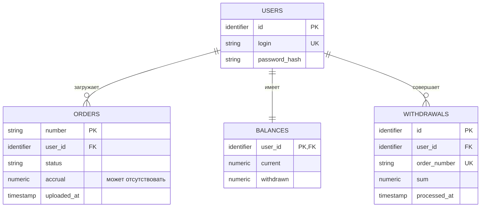

# Архитектура «Гофермарта»

## Сущности

### Пользователь

- `id` — идентификатор пользователя.
- `login` — уникальный логин.
- `password_hash` — хеш пароля.

### Загруженный заказ

- `number` — глобально уникальный номер заказа, строка цифр.
- `user_id` — идентификатор пользователя, загрузившего заказ.
- `status` — `NEW`, `PROCESSING`, `INVALID` или `PROCESSED`.
- `accrual` — сумма начисленных баллов. Может отсутствовать.
- `uploaded_at` — время первой загрузки заказа.

### Баланс

- `user_id` — идентификатор владельца баланса.
- `current` — доступный остаток баллов.
- `withdrawn` — сумма баллов, списанных за всё время.

### Списание

- `id` — внутренний идентификатор списания.
- `user_id` — идентификатор пользователя, потратившего баллы.
- `order_number` — уникальный номер оплачиваемого заказа, строка цифр. В API поле называется `order`.
- `sum` — сумма списанных баллов.
- `processed_at` — время успешного списания.

## ER-диаграмма

Ключи на диаграмме предложены для согласования схемы. У списания есть внутренний идентификатор `id`.

## Связи

| Связь | Кратность | Смысл |
| --- | --- | --- |
| Пользователь → загруженный заказ | `1 → 0..N` | У каждого заказа ровно один владелец. |
| Пользователь → баланс | `1 → 1` | У каждого пользователя есть баланс, даже если операций ещё не было. |
| Пользователь → списание | `1 → 0..N` | Каждое списание относится ровно к одному пользователю. |

`withdrawals.order_number` обозначает оплачиваемый заказ. Связь с записью загруженного заказа для списания не требуется.

## Правила

- Повторная загрузка номера тем же пользователем сохраняет исходную запись. Другой пользователь не может загрузить этот номер.
- Загруженный заказ начинается со статуса `NEW`. Статусы `INVALID` и `PROCESSED` окончательные. При `PROCESSED` с начислением статус и зачисление баллов фиксируются атомарно, чтобы повторная обработка не увеличила баланс повторно.
- Списание возможно при достаточном остатке. Проверка остатка, уменьшение доступных баллов и запись в историю составляют одну атомарную операцию.
- Баллы могут быть дробными. Начисления и списания учитываются без потери точности.
- Списание относится к новому заказу. Его номер не требует наличия записи среди загруженных заказов или проверки через `accrual`.

## Хранение баланса

- Баланс хранится в отдельной таблице PostgreSQL, по одной строке на пользователя. Строка создаётся в транзакции регистрации с `current = 0` и `withdrawn = 0`.
- `GET /api/user/balance` читает сохранённые `current` и `withdrawn`.
- При первом переходе заказа в `PROCESSED` сумма начисления увеличивает `current` в той же транзакции, что и обновление заказа.
- При списании условное обновление строки с `current >= sum` уменьшает `current` и увеличивает `withdrawn`. Запись истории добавляется в той же транзакции, только если обновление прошло.

## Представление баллов

- В PostgreSQL суммы `current`, `withdrawn`, `accrual` и `sum` хранятся как `NUMERIC` без заданного масштаба. Сравнение и обновление баланса выполняются в PostgreSQL.
- HTTP API передаёт суммы как JSON-числа. Для точного обмена значениями `NUMERIC` с PostgreSQL используем `pgtype.Numeric` из `pgx/v5`.

## Схема PostgreSQL

Для доступа из Go используем `pgx/v5`, для применения SQL-миграций из каталога `migrations/` — CLI `golang-migrate`.

| Таблица | Колонки и ограничения |
| --- | --- |
| `users` | `id BIGINT GENERATED ALWAYS AS IDENTITY PRIMARY KEY`, `login TEXT NOT NULL UNIQUE`, `password_hash TEXT NOT NULL` |
| `orders` | `number TEXT PRIMARY KEY`, `user_id BIGINT NOT NULL REFERENCES users(id)`, `status TEXT NOT NULL DEFAULT 'NEW'`, `accrual NUMERIC` с допустимым `NULL`, `uploaded_at TIMESTAMPTZ NOT NULL DEFAULT now()` |
| `balances` | `user_id BIGINT PRIMARY KEY REFERENCES users(id)`, `current NUMERIC NOT NULL DEFAULT 0`, `withdrawn NUMERIC NOT NULL DEFAULT 0` |
| `withdrawals` | `id BIGINT GENERATED ALWAYS AS IDENTITY PRIMARY KEY`, `user_id BIGINT NOT NULL REFERENCES users(id)`, `order_number TEXT NOT NULL UNIQUE` (поле `order` в API), `sum NUMERIC NOT NULL`, `processed_at TIMESTAMPTZ NOT NULL DEFAULT now()` |

- `CHECK` ограничивает статусы заказов значениями `NEW`, `PROCESSING`, `INVALID`, `PROCESSED`. Начисление может быть задано только для `PROCESSED`.
- Номера заказов состоят из ASCII-цифр. Проверка контрольной суммы выполняется в приложении.
- Начисление и поля баланса принимают только конечные неотрицательные значения. Сумма списания должна быть конечной и больше нуля.
- Для списков предлагаются индексы `orders (user_id, uploaded_at DESC, number)` и `withdrawals (user_id, processed_at DESC, id DESC)`. Для опроса `accrual` — частичный индекс `orders (uploaded_at, number) WHERE status IN ('NEW', 'PROCESSING')`.
- Для каждого `order_number` допускается одно успешное списание. Повтор с тем же пользователем, номером и суммой возвращает `200` без повторного списания. Если номер уже использован с другой суммой или другим пользователем, API возвращает `409 Conflict`.
